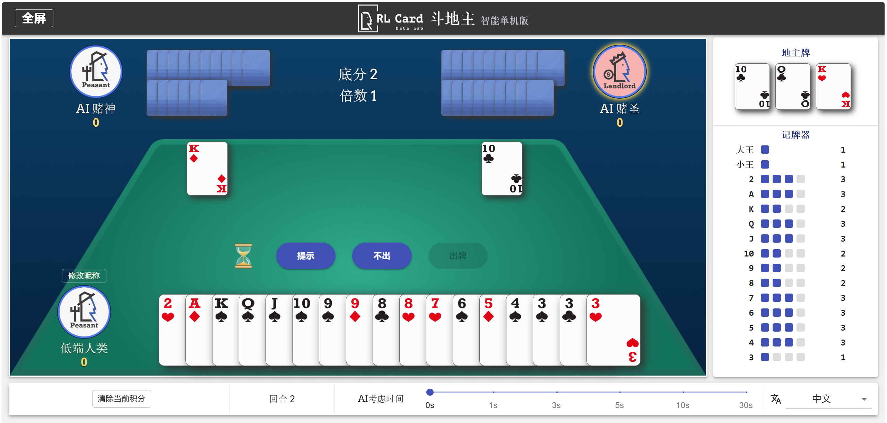

# Offline Doudizhu (斗地主) from DouZero project

A fork of [RLCard Showdown](https://github.com/datamllab/rlcard-showdown), changed into a small **offline Doudizhu game against the DouZero AI** that runs on your own computer or server. It was made for fun, not for commercial use.

What is different from the original:

- new system for the bidding phase (叫分)
- scores kept for all parties
- hint button that suggests the move with the highest win rate of the model
- the AI runs with ONNX Runtime (PyTorch is not needed)
- **settings you can edit without rebuilding:** `public/custom.css` (sizes and colours), `public/phrases.js` (the comments in the settlement window), `public/settings.js`, `public/hotkeys.js`. After a build they are in the `web` folder; change them there and a Ctrl+F5 reload to take effect.



## Run it

1. **Models (not included).** Get the DouZero pre-trained models (see the [DouZero](https://github.com/kwai/DouZero) project) and put them into `pve_server/pretrained/douzero_pretrained/` as `landlord.onnx`, `landlord_up.onnx` and `landlord_down.onnx`. (If you only have the `.ckpt` files, install PyTorch once; the server then exports the `.onnx` files itself.)
2. **Build the page** (Node.js and npm are needed):
   ```
   npm install
   REACT_APP_DOUZERO_URL= NODE_OPTIONS=--openssl-legacy-provider npm run build
   ```
   (On Windows PowerShell set the two variables first: `$env:REACT_APP_DOUZERO_URL=""; $env:NODE_OPTIONS="--openssl-legacy-provider"`. `NODE_OPTIONS` is only needed with Node.js 17 or newer.) Then copy the `build` folder to `pve_server/web`.
3. **Start the server** (Python 3):
   ```
   pip install -r pve_server/requirements-onnx.txt
   cd pve_server
   python run_douzero.py
   ```
   Open <http://127.0.0.1:5000/doudizhu>. Use `--host` and `--port` to change the address.

The server writes `score.json`, `players.json` and `play.log` next to `run_douzero.py` (scores, nicknames and a log of what happened). They are not part of the repository.

## Credits and licences

- [RLCard Showdown](https://github.com/datamllab/rlcard-showdown) and [RLCard](https://github.com/datamllab/rlcard) by the DATA Lab at Texas A&M University: the original GUI this fork is built on. When this was written, the RLCard Showdown repository had no licence file, so its terms are not stated; please look at the upstream project.
- [DouZero](https://github.com/kwai/DouZero) by Kwai (Apache-2.0): the AI and its pre-trained models.
- Parts of this fork were written with the help of Claude (Anthropic).

---
